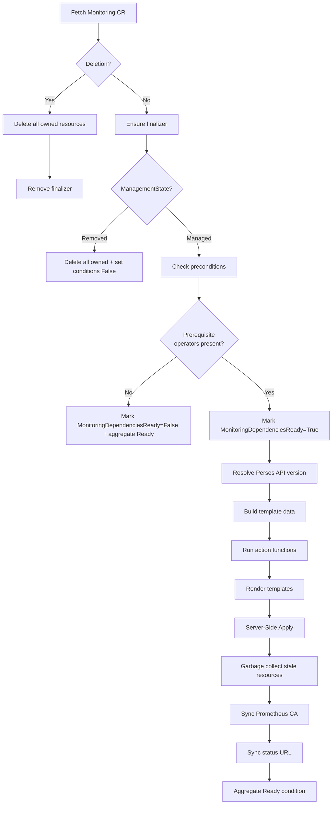
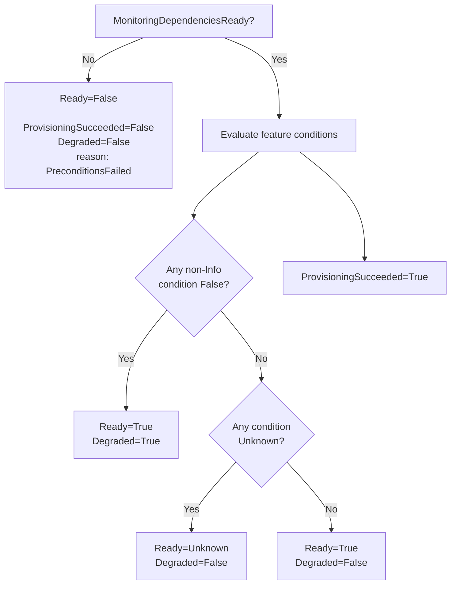

# Architecture

The odh-observability operator is a standalone Kubernetes operator that manages the full observability stack for Open Data Hub and Red Hat OpenShift AI. It reconciles a single cluster-scoped custom resource (`Monitoring`) into a set of operand resources: Prometheus via MonitoringStack, Thanos Querier, OpenTelemetry Collector, Tempo for distributed tracing, Perses dashboards, and a mutating admission webhook for automatic label injection.

**API Group:** `services.platform.opendatahub.io/v1alpha1`
**Kind:** `Monitoring`
**Scope:** Cluster (singleton, name must be `default-monitoring`)

The operator is a modularized extraction from the [opendatahub-operator](https://github.com/opendatahub-io/opendatahub-operator). It is designed to run standalone or be orchestrated by the ODH operator via the ModuleHandler pattern.

## Reconciliation Flow

The controller follows a declarative template-rendering pattern. Each reconcile cycle evaluates the CR spec, determines which features are enabled, collects the appropriate YAML templates, renders them with cluster-aware data, and applies everything atomically via Server-Side Apply.



### Precondition Checks

Before any feature deployment, the reconciler verifies prerequisite operators through OLM OperatorConditions:

| Operator | Required When |
|----------|--------------|
| `cluster-observability-operator` | Metrics configured |
| `tempo-operator` | Traces configured |
| `opentelemetry-operator` | Metrics, traces, or usage logs configured |
| `cert-manager` | Operator webhook and metrics TargetAllocator mTLS certificates |
| `loki-operator` | Usage logs or cluster log forwarding configured |
| `cluster-logging` | Cluster log forwarding configured |

If any required operator is missing, `MonitoringDependenciesReady` is set to False with the missing operator names and OperatorHub installation guidance. Reconciliation then stops without error (no retry -- the CRD watch will trigger re-reconciliation when operators are installed). The legacy `MonitoringAvailable` condition is updated in parallel for compatibility.

The metrics TargetAllocator selects labeled ServiceMonitors and PodMonitors cluster-wide because KServe creates its scheduler monitors and per-workload TLS monitors in inference workload namespaces. The collector ServiceAccount has no Secret permissions. A separate TargetAllocator ServiceAccount receives the OpenTelemetry Operator discovery permissions through a dedicated ClusterRole plus namespace-scoped Roles for the current namespace set; an upgrade-safe legacy binding is retained because ClusterRoleBinding role references are immutable. It is configured with the same `secretNamespaces` allowlist, and namespace events trigger reconciliation so new namespaces receive the binding. `denyFSAccessThroughSMs` prevents selected monitors from making the collector expose file-backed credentials.

Workload metrics are collected through eligible ServiceMonitor and PodMonitor resources. A pod label alone does not create a scrape target; workloads must expose a monitor that specifies the metrics endpoint, port, and any required authentication or TLS settings. Namespaces opt into monitor selection with `monitoring.opendatahub.io/scrape=true`, and the admission webhook adds the matching label to monitors created there.

The TargetAllocator uses mTLS by default, with cert-manager provisioning its CA, serving, and client certificates. The collector is configured only with the HTTPS TargetAllocator endpoint. The upstream TargetAllocator may also expose its non-mTLS discovery port, but `allowInsecureAuthSecrets` remains disabled so authenticated ServiceMonitor credentials cannot be returned over plaintext HTTP.

### HTTPS DCGM exporter scraping

The built-in DCGM scrape uses unauthenticated HTTP on port 9400 by default. For clusters configured with a direct HTTPS DCGM endpoint, disable only that built-in job and select a ServiceMonitor or PodMonitor instead. Ensure the monitor's namespace is opted in with `monitoring.opendatahub.io/scrape=true`, label the monitor `monitoring.opendatahub.io/scrape: "true"`, and reference a CA Secret rather than a file path; the TargetAllocator has permission to read selected monitor Secrets in allowed namespaces, while `denyFSAccessThroughSMs` blocks file-backed credentials.

TargetAllocator Prometheus CR discovery supports the `monitoring.coreos.com/v1` API group. The webhook also labels `monitoring.rhobs/v1` monitors, but those are not discovered by TargetAllocator.

Example PodMonitor (adapt selector, port, CA Secret, and server name to the installed exporter):

```yaml
apiVersion: monitoring.coreos.com/v1
kind: PodMonitor
metadata:
  name: dcgm-exporter-https
  namespace: nvidia-gpu-operator
  labels:
    monitoring.opendatahub.io/scrape: "true"
spec:
  namespaceSelector:
    matchNames: [nvidia-gpu-operator]
  selector:
    matchLabels:
      app: nvidia-dcgm-exporter
  podMetricsEndpoints:
    - port: metrics
      path: /metrics
      scheme: https
      interval: 30s
      scrapeTimeout: 10s
      tlsConfig:
        ca:
          secret:
            name: dcgm-exporter-ca
            key: ca.crt
        serverName: nvidia-dcgm-exporter.nvidia-gpu-operator.svc
      relabelings:
        - sourceLabels: [__meta_kubernetes_namespace]
          targetLabel: namespace
        - sourceLabels: [__meta_kubernetes_pod_node_name]
          targetLabel: node
        - sourceLabels: [__meta_kubernetes_pod_label_app]
          targetLabel: component
        - targetLabel: job
          replacement: rhoai-accelerator-metrics
      metricRelabelings:
        - sourceLabels: [__name__]
          regex: '(DCGM_FI_DEV_GPU_TEMP|DCGM_FI_DEV_GPU_UTIL|DCGM_FI_PROF_GR_ENGINE_ACTIVE|DCGM_FI_DEV_MEM_COPY_UTIL|DCGM_FI_DEV_FB_USED|DCGM_FI_DEV_FB_FREE|DCGM_FI_DEV_POWER_USAGE|DCGM_FI_DEV_SM_CLOCK|DCGM_FI_DEV_MEM_CLOCK)'
          action: keep
```

Set `spec.metrics.builtinDCGMScrapeEnabled: false` on a standalone `Monitoring` resource, or `spec.monitoring.metrics.builtinDCGMScrapeEnabled: false` on `DSCInitialization`, when this monitor scrapes the same DCGM targets. Omit the field (or set it to `true`) to retain built-in HTTP scraping. The namespace relabel supports namespace-proxy queries. The monitor keeps the `rhoai-accelerator-metrics` job identity, node/component labels, and DCGM metric filter expected by accelerator processing and recording rules. The collector suppresses exporter-pod attribution only for targets discovered in `nvidia-gpu-operator`; using this job label elsewhere does not disable namespace/pod attribution. Do not add a bearer token for the collector ServiceAccount: it is used for Kubernetes discovery, not DCGM authentication. If the exporter requires authentication, configure the monitor's Secret-backed `authorization` or `basicAuth`; TargetAllocator transfers those credentials only over mTLS. Never configure `insecureSkipVerify` or file-backed credential paths. The certificate must chain to the referenced CA and match `serverName`.

Prometheus follows redirects by default, so the built-in scrape keeps that behavior for compatibility. HTTPS-only DCGM endpoints should use a monitor with explicit TLS trust and hostname settings rather than relying on an HTTP-to-HTTPS redirect. Keep built-in scraping enabled only when it does not duplicate the monitor's target.

## Action Functions

Action functions run sequentially in a fixed order. Each function checks whether its feature is enabled, verifies required CRDs exist, manages its condition, and appends template sources to a shared collection.

| Order | Function | Spec Trigger | CRDs Checked | Condition | Templates |
|-------|----------|-------------|--------------|-----------|-----------|
| 1 | `deployWebhookInfrastructure` | Always | None | `WebhookAvailable` | None -- verifies the cert-manager TLS secret exists; webhook resources are deployed by the Helm chart |
| 2 | `deployOperatorMonitoring` | Always | `PrometheusRule` | None | operator-prometheusrules |
| 3 | `deployMonitoringAdmissionPolicies` | Always | None | None | monitoring-admission-policies |
| 4 | `deployMonitoringStackWithQuerierAndRestrictions` | `spec.metrics` | `MonitoringStack`, `ThanosQuerier` | `MonitoringStackAvailable`, `ThanosQuerierAvailable` | 14 templates (see inventory) |
| 5 | `deployTracingStack` | `spec.traces` | `TempoMonolithic`/`TempoStack`, `Instrumentation` | `TempoAvailable`, `InstrumentationAvailable` | Tempo template + instrumentation |
| 6 | `deployOpenTelemetryCollector` | `spec.metrics` or `spec.traces` | `OpenTelemetryCollector` | `OpenTelemetryCollectorAvailable` | collector, RBAC, ServiceMonitors, Prometheus service |
| 7 | `deployAlerting` | `spec.alerting` | `PrometheusRule` | `AlertingAvailable` | None -- condition-only check |
| 8 | `deployNodeMetricsEndpoint` | `spec.metrics` | None | `NodeMetricsEndpointAvailable` | prometheus-cluster-proxy |
| 9 | `deployKorrel8r` | `spec.metrics` or `spec.traces` or `spec.logs` | None | `Korrel8rAvailable` | ConfigMap, Deployment, Service, RBAC, NetworkPolicy |
| 10 | `deployPerses` | `spec.metrics` or `spec.traces` | `Perses` | `PersesAvailable` | perses, network-policy |
| 11 | `deployPersesTempoIntegration` | `spec.traces` | `PersesDatasource`, `PersesDashboard` | `PersesTempoDataSourceAvailable` | datasource, CA ConfigMap, dashboard |
| 12 | `deployPersesPrometheusIntegration` | `spec.metrics` | `PersesDatasource` | `PersesPrometheusDataSourceAvailable` | 2 datasource templates |

When a feature is not configured, the action calls `MarkNotConfigured` (Info severity) which prevents it from contributing to Degraded status. When a required CRD is missing, `MarkFalse` is used, which does contribute to Degraded.

## Resource Inventory

All templates are embedded via `//go:embed` and rendered with Go's `text/template` engine. They are grouped by subsystem below.

### Metrics (MonitoringStack + Thanos Querier)

| Template | Resources Created |
|----------|-------------------|
| `monitoring-stack.tmpl.yaml` | MonitoringStack CR |
| `prometheus-web-tls-service.tmpl.yaml` | Service for Prometheus TLS |
| `prometheus-self-servicemonitor.tmpl.yaml` | ServiceMonitor for self-monitoring |
| `monitoringstack-alertmanager-rbac.tmpl.yaml` | RBAC for Alertmanager |
| `data-science-prometheus-route.tmpl.yaml` | Route for Prometheus access |
| `data-science-prometheus-service-override.tmpl.yaml` | Service override for Prometheus |
| `data-science-prometheus-network-policy.tmpl.yaml` | NetworkPolicy for Prometheus |
| `data-science-prometheus-namespace-proxy.tmpl.yaml` | Namespace-scoped Prometheus proxy |
| `data-science-prometheus-namespace-proxy-network-policy.tmpl.yaml` | NetworkPolicy for namespace proxy |
| `thanos-querier-cr.tmpl.yaml` | ThanosQuerier CR |
| `data-science-thanos-querier-proxy.tmpl.yaml` | Authenticated, namespace-scoped Thanos proxy |
| `data-science-thanos-querier-proxy-network-policy.tmpl.yaml` | Router-only ingress policy for the Thanos proxy |
| `thanos-querier-route.tmpl.yaml` | Re-encrypt Route for the authorized Thanos proxy |

### Tracing (Tempo + Instrumentation)

| Template | Resources Created |
|----------|-------------------|
| `tempo-monolithic.tmpl.yaml` | TempoMonolithic CR (PV backend) |
| `tempo-stack.tmpl.yaml` | TempoStack CR (S3/GCS backend) |
| `instrumentation.tmpl.yaml` | Instrumentation CR for auto-instrumentation |
| `tempo-service-ca-configmap.tmpl.yaml` | CA ConfigMap for Tempo TLS |

### OpenTelemetry Collector

| Template | Resources Created |
|----------|-------------------|
| `opentelemetry-collector.tmpl.yaml` | OpenTelemetryCollector CR |
| `collector-rbac.tmpl.yaml` | Collector discovery RBAC, dedicated TargetAllocator ServiceAccount, upgrade-safe discovery bindings, and namespace-scoped Secret RBAC |
| `collector-servicemonitors.tmpl.yaml` | ServiceMonitors for collector metrics |
| `collector-prometheus-service.tmpl.yaml` | Prometheus receiver service |

### Alerting

| Template | Resources Created |
|----------|-------------------|
| `operator-prometheusrules.tmpl.yaml` | PrometheusRule for operator alerts |

### Perses (Dashboards)

| Template | Resources Created |
|----------|-------------------|
| `perses.tmpl.yaml` | Perses CR |
| `perses-operator-access-network-policy.tmpl.yaml` | NetworkPolicy for Perses operator |
| `perses-tempo-datasource.tmpl.yaml` | PersesDatasource for Tempo |
| `perses-tempo-dashboard-v1alpha1.tmpl.yaml` | PersesDashboard (v1alpha1 API) |
| `perses-tempo-dashboard-v1alpha2.tmpl.yaml` | PersesDashboard (v1alpha2 API) |
| `perses-datasource-prometheus.tmpl.yaml` | PersesDatasource for Data Science metrics via Thanos proxy (:8443, requires `namespace=`, default) |
| `perses-datasource-cluster-prometheus.tmpl.yaml` | PersesDatasource for OpenShift Monitoring cluster-wide (:9091, **caller token / RBAC**, not shared SA, not default) |
| `perses-datasource-cluster-prometheus-tenancy.tmpl.yaml` | PersesDatasource for OpenShift Monitoring tenancy (:9092, requires `namespace=`) |

Perses metrics access model (three lanes — pick by **where the series live**, not by dashboard title):

| Lane | Datasource | Backend | Gate | Owns |
|------|------------|---------|------|------|
| **DS namespace-scoped** | `data-science-prometheus-datasource` (default) | DS Thanos proxy `:8443` | `namespace=` + caller token + `metrics.k8s.io` SAR | Series in the Data Science MonitoringStack (e.g. `kserve_vllm:*`, DS `accelerator_*` recording rules from OTC/DCGM) |
| **OCP tenancy** | `cluster-prometheus-tenancy-datasource` | OpenShift Thanos `:9092` | `namespace=` + caller token | Namespaced OpenShift Monitoring series (`node_namespace_pod_container:*`, `kube_*`, OCP accelerator with `exported_namespace` / `exported_pod`) |
| **OCP admin** | `cluster-prometheus-datasource` | OpenShift Thanos `:9091` | caller RBAC only (e.g. `cluster-monitoring-view`) | Cluster-wide admin views — **not** namespace tenancy |

**Do not conflate the gates.** `:8443` is DS namespace scoping. `:9091` is RBAC. `:9092` is OpenShift tenancy.

**BREAKING (default datasource):** `data-science-prometheus-datasource` is now `default: true` and requires `namespace=` on every query (enforced by the proxy). Panels that omit an explicit datasource name and previously hit cluster Prometheus will now hit the DS proxy and fail without `namespace=`. Product Observe dashboards must pin explicitly (`cluster-prometheus-datasource` / `cluster-prometheus-tenancy-datasource`). Custom/ Perses dashboards that relied on the old default must either pin a datasource or pass `namespace=`.

The [MaaS legacy usage dashboard](https://github.com/opendatahub-io/models-as-a-service/blob/main/deployment/components/observability/observability/dashboards/usage-dashboard.yaml) explicitly uses the DS datasource but has no `namespace` variable. It needs a compatible namespace selection and authorization design before this change can be rolled out; the Observe dashboard companion alone does not update it.

**Metric ownership / dashboard pins (hard rule):** one PromQL query runs against **one** datasource. You cannot join DS Thanos series with OpenShift series in a single query. Observe dashboards (Dashboard repo) must pin explicitly after the DS default flip:
- **Models:** `kserve_vllm:*` panels → `data-science-prometheus-datasource` (`:8443`). OCP GPU/CPU panels → `cluster-prometheus-tenancy-datasource` (`:9092`).
- **Cluster:** → `cluster-prometheus-datasource` (`:9091`).
- **Out of scope for RHOAIENG-99814:** rewriting GPU/CPU PromQL that still references `kserve_vllm:*` inside a tenancy query (cross-stack join). That is a separate metric-ownership change.

- Upgrade: the reconciler removes legacy Kubernetes SA-token Secrets with these datasource names only when they are owned by the current Monitoring resource and reference the old cluster-proxy service account. Perses operator manages separate Perses API secrets for the datasource TLS configuration.
- Observe UI / gateway → Perses ingress is owned by Dashboard (`dashboard-perses-access`), not this operator.

### Korrel8r (Signal Correlation)

| Template | Resources Created |
|----------|-------------------|
| `korrel8r-config.tmpl.yaml` | Operator-owned store and tuning configuration |
| `korrel8r-deployment.tmpl.yaml` | Single-replica Deployment and ClusterIP Service |
| `korrel8r-rbac.tmpl.yaml` | ServiceAccount and TokenReview delegation |
| `korrel8r-network-policy.tmpl.yaml` | Ingress and backend egress policy |

### Node Metrics

| Template | Resources Created |
|----------|-------------------|
| `data-science-prometheus-cluster-proxy.tmpl.yaml` | Cluster-wide Prometheus proxy |

### Webhook Infrastructure

The webhook resources are **not** rendered by the operator. They are deployed by the Helm chart at install time in [`charts/odh-observability/templates/webhook.yaml`](../charts/odh-observability/templates/webhook.yaml).

| Resource | Deployed By |
|----------|-------------|
| Service for webhook endpoint | Helm chart |
| cert-manager Certificate + Issuer | Helm chart |
| MutatingWebhookConfiguration | Helm chart |

### Admission Policies

| Template | Resources Created |
|----------|-------------------|
| `monitoring-admission-policies.tmpl.yaml` | ValidatingAdmissionPolicy + Binding |

## Condition System

The operator manages feature-specific conditions that aggregate into 3 top-level conditions required by the PlatformObject contract.

### Feature Conditions

Each action function manages one or more conditions:

| Condition | Set By |
|-----------|--------|
| `MonitoringDependenciesReady` | External operator precondition check |
| `MonitoringAvailable` | Legacy alias of `MonitoringDependenciesReady` |
| `MonitoringStackAvailable` | `deployMonitoringStackWithQuerierAndRestrictions` |
| `ThanosQuerierAvailable` | `deployMonitoringStackWithQuerierAndRestrictions` |
| `TempoAvailable` | `deployTracingStack` |
| `InstrumentationAvailable` | `deployTracingStack` |
| `OpenTelemetryCollectorAvailable` | `deployOpenTelemetryCollector` |
| `AlertingAvailable` | `deployAlerting` |
| `PersesAvailable` | `deployPerses` |
| `PersesTempoDataSourceAvailable` | `deployPersesTempoIntegration` |
| `PersesPrometheusDataSourceAvailable` | `deployPersesPrometheusIntegration` |
| `NodeMetricsEndpointAvailable` | `deployNodeMetricsEndpoint` |
| `WebhookAvailable` | `deployWebhookInfrastructure` |
| `Korrel8rAvailable` | `deployKorrel8r` |

### Condition Severities

The `ConditionsManager` supports three marking methods:

- **`MarkTrue`** -- Feature is available. Status=True, Reason="Available".
- **`MarkFalse`** -- Feature is degraded (e.g. missing CRD). Status=False. Contributes to Degraded=True.
- **`MarkNotConfigured`** -- Feature is not enabled in the spec, or is in a transient bootstrapping state. Status=False, Severity=Info. Excluded from Degraded aggregation.

### Aggregation Logic



The key design decision: unconfigured features (Info severity) do not make the operator appear degraded. Only actual failures -- like a missing CRD for a configured feature -- trigger Degraded=True.

## Template Data Pipeline

The `buildTemplateData()` function transforms the CR spec and cluster state into a flat `map[string]any` that all Go templates consume.

### Data Sources

| Source | Data Produced |
|--------|---------------|
| CR spec | Namespace, feature flags (Metrics/Traces booleans), storage config, TLS config |
| Environment variables | `POD_NAMESPACE`, `OPERATOR_NAME`, optional `GATEWAY_NAMESPACE`, and `RELATED_IMAGE_*` for operand images |
| Cluster probing | SNO detection (single-node OpenShift), Perses API version (v1alpha1 vs v1alpha2) |
| Defaults | Resource limits, retention periods, sample ratios, storage sizes |

### SNO Awareness

The operator detects single-node OpenShift clusters and adjusts defaults:
- **CollectorReplicas**: 1 on SNO, 2 on multi-node (unless explicitly set in spec)
- **MonitoringStack replicas**: adjusted for SNO constraints

### Exporter Validation

Custom OTel exporters (`spec.metrics.exporters`, `spec.traces.exporters`) go through a validation pipeline:
- Reserved name check (blocks `otlp/tempo`, `prometheus`)
- Component ID regex validation
- Size limits: 10KB per exporter, 50KB total
- YAML security validation: max 50 fields, max 10 nesting depth, max 1024 string length, max 100 array length
- Schema validation for known types: `otlp`, `otlphttp`, `debug`, `prometheusremotewrite`
- Secure endpoint enforcement: blocks insecure HTTP for non-local endpoints

## Mutating Admission Webhook

The operator includes a mutating admission webhook that injects the `monitoring.opendatahub.io/scrape=true` label onto `ServiceMonitor` and `PodMonitor` resources in both the `monitoring.coreos.com/v1` and `monitoring.rhobs/v1` API groups.

### How It Works

1. A namespace opts in by having the label `monitoring.opendatahub.io/scrape=true`.
2. When a ServiceMonitor or PodMonitor is created/updated in an opted-in namespace, the webhook intercepts the request.
3. The webhook verifies the `default-monitoring` CR exists (monitoring is active).
4. If the object does not already have the label, the webhook injects `monitoring.opendatahub.io/scrape: "true"` via JSON patch.

This label is what makes the MonitoringStack's Prometheus instance discover and scrape the monitor.

### Admission Probe

The webhook uses `failurePolicy: Fail` by default, so an outage rejects admission instead of allowing monitors through without the scrape label. Deployments that prioritize availability during operator restarts can set the Helm value to `Ignore`. The operator runs an in-process probe every 5 minutes that writes a canary PodMonitor and checks that the webhook labeled it; the result is exported as `webhook_admission_probe_*` metrics and drives the `MonitoringWebhookAdmissionPathDown` alert.

The canary lives in a dedicated namespace (`webhook.probe.namespace`, default `<fullname>-webhook-probe`) that the Helm chart creates with `monitoring.opendatahub.io/scrape=true`, so the webhook `namespaceSelector` matches it without opting real monitors in the monitoring namespace into scraping. The operator reads the namespace from `WEBHOOK_PROBE_NAMESPACE`; the probe is disabled when it is unset and counts a failure when the namespace lacks the label.

### Self-Bootstrapping

The webhook resources (Service, Certificate, Issuer, and MutatingWebhookConfiguration) are deployed by the Helm chart at install time, not by the operator.

The operator's role is limited to:

1. Verify that the TLS secret (generated by cert-manager from the Helm-deployed Certificate) exists and is ready.
2. During bootstrapping (before cert-manager provisions the secret), the `WebhookAvailable` condition uses Info severity (`MarkNotConfigured`) so the operator does not appear degraded while waiting for the secret to be provisioned.

This design decouples webhook infrastructure provisioning (Helm) from webhook readiness verification (operator), ensuring the operator can safely verify certificate readiness without managing the resources that create the certificates.


## Garbage Collection

The operator uses label-based garbage collection to remove resources that are no longer desired.

After each reconcile, `collectGarbage()` compares the set of resources that were just rendered and applied (the "desired" set) against all resources on the cluster labeled with `PlatformPartOf=monitoring` in the target namespace. Any resource in the actual set but not in the desired set is deleted.

This handles scenarios like:
- A feature being deconfigured (e.g. removing `spec.traces` removes all Tempo resources)
- Template changes that rename or remove resources across upgrades
- The `Removed` management state, which triggers `deleteAllOwned()` to remove everything

## Namespace-Scoped Metrics

The operator deploys namespace-scoped proxy paths for both the Prometheus route and the data-science Thanos route. `kube-rbac-proxy` authenticates and authorizes the namespace, the method gate limits requests, and `prom-label-proxy` enforces the namespace label in PromQL.

```
User Request
    |
kube-rbac-proxy (port 8443)
    |-- Authenticates via bearer token (TokenReview)
    |-- Extracts 'namespace' query parameter
    |-- Performs SubjectAccessReview for metrics.k8s.io/pods
    |
method-gate (port 9092)
    |-- Allows GET/HEAD; Thanos also allows safe read-only form POSTs
    |
prom-label-proxy (port 9091)
    |-- Validates namespace parameter is present
    |-- Validates and enforces namespace values in PromQL
    |-- Prometheus proxy rejects duplicates; Thanos proxy accepts multiple values
    |
Prometheus (port 9090)
```

**Authentication**: kube-rbac-proxy validates bearer tokens via Kubernetes TokenReview API.

**Authorization**: kube-rbac-proxy performs a SubjectAccessReview with a static `resourceAttributes.verb: get` on `metrics.k8s.io/pods` for every requested URL-query namespace. The check applies to both GET and POST. The old aggregated `data-science-metrics-view` ClusterRole is no longer rendered and is eligible for removal during upgrades.

**Method enforcement (independent of RBAC)**: the method-gate sidecar uses the operator's own image. The Prometheus proxy permits only GET/HEAD. The Thanos proxy also permits URL-encoded form POSTs to read-only query and label APIs, for Perses; it rejects unsupported methods and paths, malformed or encoded forms, and any form-body `namespace`. This prevents prom-label-proxy from merging an unauthorized body namespace into the URL-authorized label matcher. The namespace must always be in the URL.

**Query isolation**: prom-label-proxy rewrites PromQL to inject the namespace matcher (`namespace="a"` or `namespace=~"a|b"` for multi-select / Project=All). Project=All must expand to concrete namespaces, not a wildcard. The Thanos proxy omits `--regex-match` to allow repeated `namespace=` values; kube-rbac-proxy checks every URL value. The Prometheus namespace proxy retains `--regex-match` and rejects duplicates.

**Follow-up**: once a verified prom-label-proxy image supports query-only extraction, RHOAIENG-101998 tracks enabling it as an additional safeguard and retaining mixed URL/form and multi-namespace tests.

**TLS profile ownership**: The controller resolves the effective APIServer TLS profile and writes the resulting version, cipher-suite, and curve-preference flags into the PodTemplates of all generated kube-rbac-proxy workloads: the Prometheus namespace proxy, Prometheus cluster proxy, and Thanos Querier proxy. The proxy image does not watch OpenShift TLS resources. `RELATED_IMAGE_ODH_KUBE_RBAC_PROXY_IMAGE` only selects the image; it does not configure TLS. Under strict adherence, an unrepresentable profile fails reconciliation before any workload is applied. TLS 1.3 omits the cipher-suite restriction because Go does not make TLS 1.3 cipher suites configurable. Curve preferences are emitted as numeric Go CurveIDs, with non-FIPS-approved curves dropped when the cluster install configuration reports FIPS mode. If cluster FIPS status cannot be determined, reconciliation fails before any workload is applied.

**Network isolation**: The Prometheus proxy NetworkPolicy restricts ingress to the configured gateway namespace and Alertmanager. The Thanos proxy NetworkPolicy restricts ingress to the configured gateway (or OpenShift ingress policy-group when `GATEWAY_NAMESPACE` is empty) **and** to Perses pods (`instance` / `app.kubernetes.io/name: data-science-perses`) on TCP/8443 — in-cluster Observe queries must hit the namespace gate, not raw Thanos `:10902`.

**API-server and webhook paths**: Korrel8r's egress policy allows only the ready Kubernetes API EndpointSlice addresses on TCP/6443 and records the node-sourced API-server path as an explicit exception. The mutating webhook has the same platform-managed exception because admission calls originate from the control plane and standard NetworkPolicy cannot reliably express that node source; the rendered `MutatingWebhookConfiguration` records `platform.opendatahub.io/webhook-network-policy=platform-managed-exception`. These annotations are descriptive contracts, not enforcement. The operator does not install a host-network NetworkPolicy or `AdminNetworkPolicy`; the owning control, when present, is the cluster platform/network-admin configuration for host-network or external control-plane traffic, scoped to the API-server/admission path. A cluster without that complementary control must be qualified live and reported as an explicit limitation.

The external `data-science-thanos-querier-route` terminates at `data-science-thanos-querier-proxy` using re-encrypt TLS; it never targets the ThanosQuerier Service directly. The controller populates the Route's destination CA from the OpenShift service CA so the router validates the proxy's serving certificate. The Thanos proxy forwards the authorized and label-constrained request to the existing Thanos Querier on port `10902`, preserving the backend used by internal consumers.

## Controller Setup and Watches

The controller watches multiple resource types to detect drift and react to cluster changes:

| Watch Target | Purpose |
|-------------|---------|
| `Monitoring` CR | Primary reconcile trigger |
| Managed resources (Deployment, Service, ConfigMap, Secret, Role, RoleBinding, ClusterRole, ClusterRoleBinding, NetworkPolicy, Job, ServiceAccount, Route) | Drift detection -- re-reconciles if labeled resources are modified |
| `CustomResourceDefinition` | Reacts when optional operators (COO, Tempo, OTel, Perses, cert-manager) are installed or removed |

All managed resource watches use a label predicate (`PlatformPartOf=monitoring`) and a singleton handler that always enqueues `{Name: "default-monitoring"}`.
